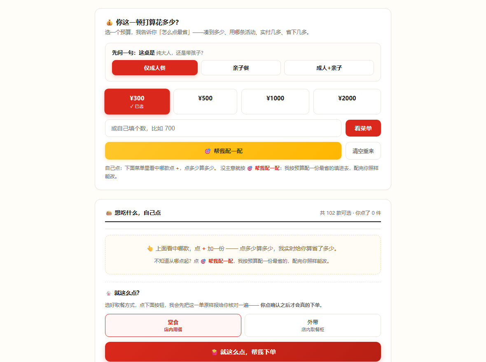
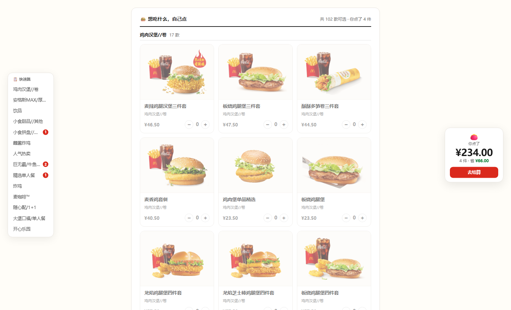
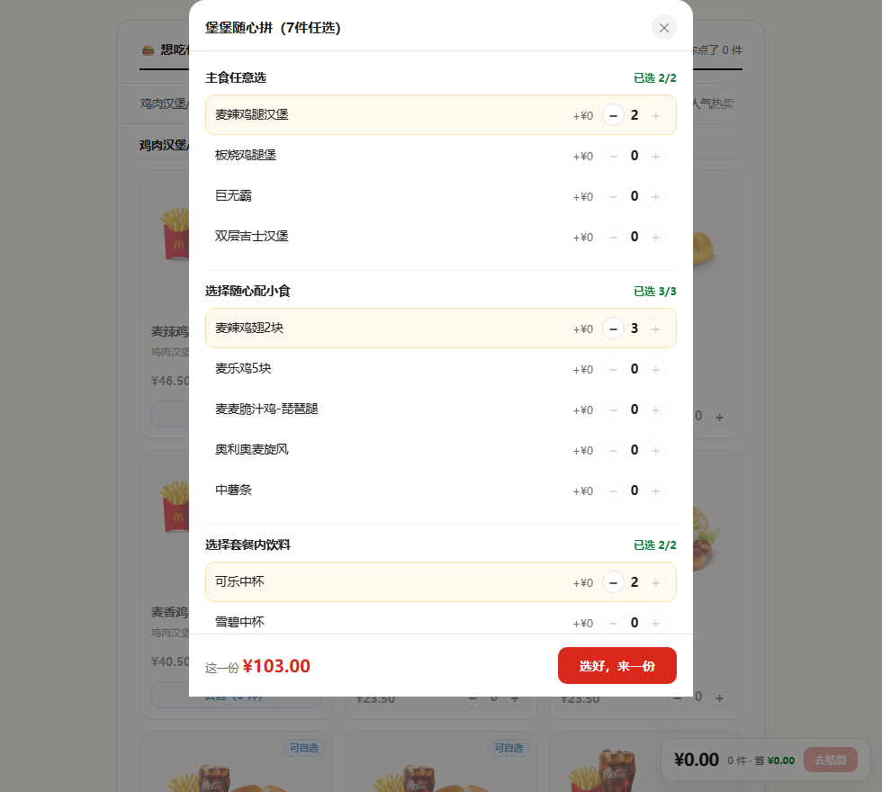
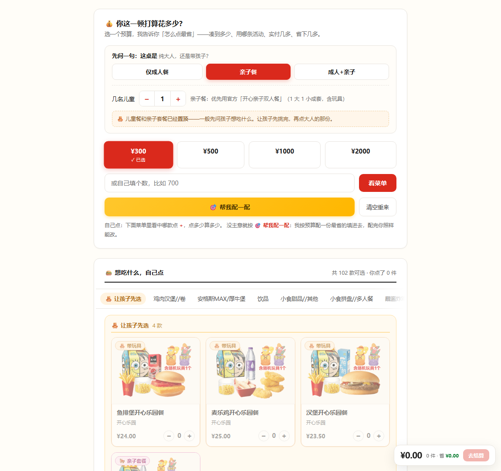
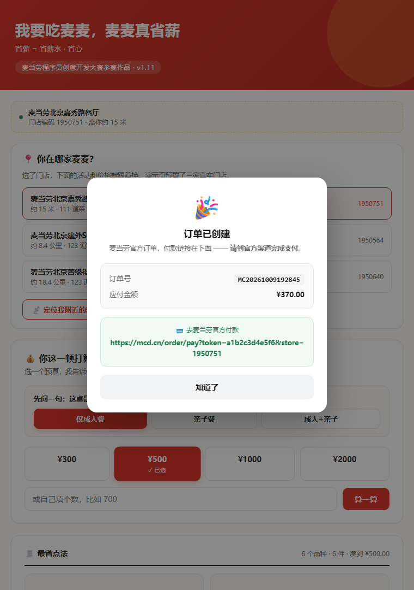

# 麦门搭子（暂名）· 说一句，麦麦就到

> 一个跑在电脑上的麦当劳点餐 Agent：**你说想吃什么，它替你点好。**

**你不用碰手机，也不用开口。**

办公室，下午。电脑开着，手机静音躺在一边。
想吃了，跟它说一句：

> 「来份麦辣鸡腿堡套餐，送到公司」

它把剩下的都做了——**调菜单、领券、算优惠、下单**。
你支付完，坐等外卖。

**i 人的福音。**

---

## 它能干什么

| 能力 | 说明 |
|---|---|
| 🏪 **找门店** | 按城市 + 关键词找到你附近的门店，**按距离排序**（到店 / 外送 / 得来速） |
| 📍 **定位附近** | 浏览器原生定位拿坐标，配地名反查即可"离你最近" |
| 🖼️ **看图点单** | 每道菜带**麦当劳官方产品图**（含动图），看得见才有食欲 |
| 🍔 **看真实菜单** | 拉当前门店的实时菜单，带**现价、原价、分类、标签** |
| 🎫 **自动领券** | **替你领**（不是提醒你去领）：把「麦麦省」能领的券全领了，再把这一单能用的**挂上** —— 你不用知道有什么券 |
| 🧮 **算省多少** | 算清**门店现价折扣 + 券**，给出原价 / 实付 / **省下多少** |
| 🍽️ **点单表** | **全部菜品带图摊开**（按分类分组），每款默认 **0 份**，点多少算多少 |
| 📊 **实时算账** | 边点边算：原价 / 省多少 / 实付 |
| 🧸 **儿童餐看图选** | 儿童餐并入菜单（带 🧸 标），**不按"几号娃"选文字、也不填几人**——直接点份数 |
| 👶 **让孩子先选** | 选了「亲子餐 / 成人+亲子」→ 儿童餐和亲子套餐**自动置顶**成一组 |
| 🧭 **分类导航** | 左边一列品类，点一下**直接跳到那一类**；滚动时自动高亮当前类；**已点的品类带角标**（宽屏窄屏都看得到） |
| ✋ **已点入口** | 导航条最前面固定一个「已点 N 件」，一点直接看账单（窄屏横滑时尤其有用） |
| 🥡 **套餐自选** | 「随心拼 / 随心选」**真能选**：每轮选够官方要求的件数、换贵的照实加钱（**100 款有真实数据**） |
| 👛 **随身钱包** | 右边跟着走的小钱包，实时显示金额，边点边看 |
| ⏭️ **跳行跟随** | 选完门店、点完「看菜单」，**自动把你带到该看的地方**，不用自己找下一步 |
| 🛒 **一键下单** | 算完直接下单（**二次确认**后才创建，返回**官方支付链接**，不代付） |
| ↩️ **可取消** | 点错了能撤（含官方 6 种取消原因） |

> **⚠️ 2026-10-10 变更（方案 A）**：首页的「**选预算 → 帮我配一配**」已**退休**。
> 因为它建立在**满减门槛**上，而**到店 / 外送根本没有满减**（见下）——留着也是坏的。
> **企业团餐那套「按门槛凑单」的能力没删**，仍在引擎里
> （`savings_engine.plan_cheapest` / `mai_mai.fetch_group_promotions`），
> 将来要做团餐场景可直接接回。

### ⚠️ 关于"优惠"：真优惠是「券 + 门店折扣」，**不是满减**

**2026-10-10 实测更正**：早先版本里写的"满 ¥300 减 22%"——**是错的**。
那是**企业团餐**（beType=6）的规则，**到店自取和麦乐送都用不上**。

| | 真实情况 |
|---|---|
| **到店 / 外送有满减吗** | ❌ **没有**（三家店 × 大额单实测：折扣恒为 0） |
| **那靠什么省** | ✅ **门店现价折扣**（最高见过 28%）＋ **券**（指定商品特价） |
| **券能和门店价叠加吗** | ✅ **能**（实测：¥324 的单，券再减 ¥2） |

**⇒ 别再说"凑满减"了。** 用户听得懂"领张券省 2 块"，不该被"满减门槛"绕晕。

---

## 实测效果

三家真实门店，实时从 MCP 拉数据算出来的：

| 门店 | 预算 | 凑到 | 用上活动 | 实付 | **省下** |
|---|---|---|---|---|---|
| 嘉秀路（离你 15 米） | ¥300 | ¥298.00 | 满 300 减 22% | ¥232.44 | **¥65.56** |
| 嘉秀路 | ¥500 | ¥500.00 | 满 500 减 26% | ¥370.00 | **¥130.00** |
| 嘉秀路 | ¥1000 | ¥999.50 | 满 1000 减 30% | ¥699.65 | **¥299.85** |
| 建外SOHO(A座) | ¥1000 | ¥1000.00 | 满 1000 减 30% | ¥700.00 | **¥300.00** |

> **同一笔钱，不同门店活动力度不一样。** 这就是"先看再吃"的价值。

以上数字由程序**实时从麦当劳 MCP 拉取并计算**，不是示例数据。

### 长什么样

<p align="center">
  
  
</p>
<p align="center">
  
  
</p>
<p align="center">
  
</p>

---

## 关于「怎么点最省」的算法

这不是简单地"往门槛上凑"。早期版本用贪心拼命凑数，结果算出来的是
**28 个圆筒冰淇淋**这种单子——数学上省得多，现实里没人这么点。

现在的做法（`savings_engine.plan_cheapest`）：

1. **预算是上限，不是门槛**（这一条最容易被写错）
   填 ¥400 就按 ¥400 算，填 ¥777 就按 ¥777 算；
   **不是**"找最近的活动门槛然后按那个算"。
2. **主餐优先**：只用汉堡 / 套餐 / 炸鸡这类主餐凑单，
   饮品甜品只作补充（且不超过总件数的 1/3）
3. **铺品种再补份数**：先用贵的各来 1 份（团餐就是摆一桌），
   差得多了再给主菜加份数
4. **补单跨线**：凑单最怕"差一点点"——门槛 ¥300 凑到 ¥298，券就用不上。
   所以有一道专门的补单逻辑，**三级**：
   - ① **加一件**跨线；
   - ② **换一件**（拿掉一件，换成更贵的）；
   - ③ **拿掉一件、换进 2~3 件**（小组合搜索）——对付那种
     "缺口只有 ¥0.5、可任何单件都比缺口贵"的死角。
     例：亲子餐 2 娃凑到 ¥299.5 差 ¥0.5，单件补不上；
     把 ¥180.5 那对拆成 ¥115.5 + ¥54.5 + ¥11 就恰好 **¥300.00**。
5. **件数封顶**：按预算自适应（约 ¥50/件，上下限 8~40 件）
6. **排除非食品**：联名棒球帽、按摩捶这类周边不进方案
7. **先问一句"有没有孩子"**（这条是人情世故，不是数学）
   见下一节。

结果就是一单看着像**真人点的团餐**，而不是凑数比赛。

### 用餐人构成：先问"这桌有没有孩子"

纯大人局拿「开心乐园餐」凑单，数学上可能更省，但**现实里没人这么点**——
那是给小孩的，还送玩具。

反过来，带娃吃饭漏了儿童餐，**玩具不够分，孩子要闹**。

所以多了一个前置问题：

| 构成 | 参数 | 行为 |
|---|---|---|
| **仅成人** | `--diners adult` | 儿童餐、亲子套餐**全排除** |
| **亲子** | `--diners kids --kids N` | ⭐ 官方亲子套餐**打底**，大人侧优先**成套/分享餐**（一家人摆一桌） |
| **成人+亲子** | `--diners mixed --kids N` | ⭐ 官方亲子套餐**照打底**，但大人侧**单品自由**（想点单只汉堡也行） |

#### 官方亲子套餐：带娃场景都优先，不是某一档的专利

**「开心亲子双人餐」是商家设计的官方产品**——一份就含 1 份大人主餐
+ 1 份带玩具的儿童餐，官方定位「1 大 1 小」。既然是官方产品，
**带娃场景就该优先用上**，不然这个产品设计就白做了。

所以「亲子餐」和「成人+亲子」**都会**优先用官方套餐，
两者的区别在**大人那半边怎么点**：

- **亲子餐**（`kids`）＝ 一家人吃，**成套/分享为主**。官方套餐打底，
  大人侧优先点双人餐 / 多人餐 / 分享餐，摆一桌，不散点单只汉堡。
- **成人+亲子**（`mixed`）＝ **单品自由**。官方套餐照样打底，
  但大人想点啥点啥（单只汉堡也行），不硬凑成套。

> 官网原文把「开心亲子双人餐」归在**金拱门桶类**（原话：
> 「金拱门桶类指定产品为【金拱门双人堡堡桶、金拱门家庭欢聚桶、**开心亲子双人餐**】」），
> 内容约等于 麦辣鸡腿堡×1 + 麦乐鸡开心乐园餐(含玩具)×1 + 薯条(中)×1 + 可乐(中)×1。

**关键细节**：只有名字像"餐"的才算带玩具的餐。
「开心乐园」分类下还有个「如意百宝袋」（¥12，是个袋子/周边），
它**不算**餐——真正的儿童套餐是
「汉堡/麦乐鸡/鱼排堡开心乐园餐」（¥23.5~25，含餐+玩具）。

**份数是锁死的**：带玩具的餐数量 **= 儿童人数**，一份不多、一份不少
（儿童餐 + 亲子套餐**合计**）。凑单的填充池**不含**单份儿童餐——
不然为了顶门槛，会给你凑出「第二个娃的餐」，多花一份钱、多一个重复玩具。
代码里还有一道 `clamp_kids` 总闸门兜底。

#### 儿童餐点哪款？让孩子自己挑

「开心乐园」下的单人儿童餐**有三款**，不是一款：

| 款式 | 价格 | 说明 |
|---|---|---|
| 汉堡开心乐园餐 | ¥23.5 | 汉堡 + 玩具 |
| 鱼排堡开心乐园餐 | ¥24 | 鱼排堡 + 玩具 |
| 麦乐鸡开心乐园餐 | ¥25 | 麦乐鸡 + 玩具 |

早期版本只挑**最便宜**那款（¥23.5 汉堡）——省钱是省钱了，
但**老大想吃麦乐鸡、老二不吃鱼**的时候，方案就不好使。

所以加了**逐娃点口味**：几个娃就出几行，每行让他选
「都行 / 汉堡 / 鱼排堡 / 麦乐鸡」。

- **全选「都行」** → 走官方亲子套餐打底（最省），不做没必要的挑拣；
- **有娃点了名** → 那位娃**照他点的来**，剩下没点名的按最省；
  ⚠️ 有人点了名就**不再套官方套餐**（官方套餐里的儿童餐款式是固定的，
  没法换口味），改成散点，把口味让出来。

> ⚠️ **演示页上的「娃想吃哪款」逐娃行已于 2026-10-09 删除**（儿童餐并入菜单、带图直接点份数）；
> 命令行仍保留 `--kid-picks 汉堡,麦乐鸡`（逗号分隔，按顺序对应第 1、2 个娃），供配餐场景用。

**关键细节**：只有名字像"餐"的才算带玩具的餐。

> 演示页上对应「仅成人餐 / 亲子餐 / 成人+亲子」三选一
> （⚠️ **"几名儿童"步进器已于 2026-10-10 删除** —— 下面菜单里直接点份数就行，
>   再单问"几个娃"是多余的；这个数原来只喂给配餐算法）；
> 官方亲子套餐挂 🎠 亲子套餐 徽标、单人儿童餐挂 🧸 带玩具 徽标，
> 每种模式还给一句说明，讲清两条路的差别。

### 实测：预算填多少，就算多少

| 预算 | 凑到 | 用上活动 | 实付 | 省下 |
|---|---|---|---|---|
| ¥300 | ¥300.00 | 满 300 减 22% | ¥234.00 | **¥66.00** |
| ¥400 | ¥400.00 | 满 300 减 22% | ¥312.00 | **¥88.00** |
| ¥500 | ¥500.00 | 满 500 减 26% | ¥370.00 | **¥130.00** |
| ¥777 | ¥774.50 | 满 500 减 26% | ¥573.13 | **¥201.37** |
| ¥1000 | ¥1000.00 | 满 1000 减 30% | ¥700.00 | **¥300.00** |
| ¥1200 | ¥1199.00 | 满 1000 减 30% | ¥839.30 | **¥359.70** |
| ¥2000 | ¥2000.00 | 满 2000 减 34% | ¥1320.00 | **¥680.00** |

**每一档数字都不同**——填多少预算，就真的按多少算。

### 实测：用餐人构成真的会改方案

同一家店（嘉秀路），同样的预算（¥500），三种构成出的单子不一样：

| 构成 | 官方套餐 | 凑到 | 省下 | 大人侧 |
|---|---|---|---|---|
| 仅成人 | — | ¥500.00 | ¥130.00 | 主餐 + 配菜自由 |
| 亲子 · 1 娃 | **官方套餐 ×1**（🎠） | ¥500.00 | ¥130.00 | **成套/分享为主** |
| 成人+亲子 · 2 娃 | **官方套餐 ×2**（🎠） | ¥500.00 | ¥130.00 | **单品自由** |
| 成人+亲子 · 2 娃（老大汉堡 / 老二麦乐鸡） | 散点（有人点名就不套套餐） | ¥500.00 | ¥109.78 | 各自点的款 |

### 实测：逐娃口味点谁出谁

同一家店、¥500 预算、2 个娃：

| 点法 | 结果 |
|---|---|
| 都「都行」 | 官方亲子套餐 **×2**（省 ¥130.00，最多） |
| 老大汉堡 + 老二麦乐鸡 | 汉堡开心乐园餐 + 麦乐鸡开心乐园餐（省 ¥109.78） |
| 两娃都要麦乐鸡 | 麦乐鸡开心乐园餐 **×2** |

**三种构成、三种点法**；带娃的两种都优先用官方套餐，
区别在大人那半边是"成套"还是"自由"。**带玩具的餐份数严格等于儿童人数**——
3 店 × 20 种组合 = 60 组断言，Python 与网页 JS 两侧全过。

---

## 一份不寒碜的清单：单款份数上限

算法有个最容易被一眼看穿的毛病：**同一款被堆一堆**。

用户在 ¥2000 的家庭局里看到「BFF四宫格小食盘双人餐 ×13」，
或者在 ¥1200 的局里看到「韩式烟熏芝士风味酱 ×5」——
数学上确实凑到了门槛、也确实最省，**但没人会这么点**。

### 三层根因

| # | 病根 | 后果 |
|---|---|---|
| 1 | 第二轮"无脑填满"——逮住最贵那款一路加到把预算填满 | 款数少时同一款堆到十几份 |
| 2 | 造单时"主餐一个人扛"——主餐池要独自吃下整个预算 | 亲子池只有 5 款分享餐，扛不动就堆 |
| 3 | 件数上限按钱估（`预算/50`）——¥2000 给 40 件 | 2 个人的单里塞 40 件东西 |

### 三道闸

| # | 闸 | 口径 |
|---|---|---|
| 1 | **单款份数上限** | 件数上限÷3、下限 2、**绝对封顶 8**；**便宜货（≤¥15）只许 2 份** |
| 2 | **主餐 + 配菜合池** | 金额摊到 20+ 款上，谁都不用堆 |
| 3 | **件数按人头** | `人数 × 3`，预算只做温和放宽 |

对比（同店 ¥2000 亲子局）：

| | 修复前 | 修复后 |
|---|---|---|
| 清单 | `BFF四宫格双人餐 ×13` + 4 款 | **18 款，每款 ×1** |
| 单款最多 | **13 份** | **1 份** |

### 为什么"便宜货"卡得更紧

同样 5 份，含义完全不同：

- 5 份汉堡 → 可以接受（团餐、一家人各一个）
- 5 包 ¥3 蘸酱 → **荒谬**（谁点五包酱？）

所以上限不只跟预算走，还要看**这一款多少钱**。
便宜的是"加料"，贵的是"一份饭"——**加料不该出现三份以上。**

### 但"同款多份"还有另一半没堵住

上限挡住了"堆 13 份"的极端情况，**却漏了"堆 3 份"的常见情况**。

用户报：「300 元档，默认的是三款，最后一款默认的是 N=2。」

一查，那不是"三款"——是**同一款出现了两条**（渲染成两张一样的卡），
实际只有**两款**不同的东西。而这暴露出更深的问题：

> 算法把金额凑够了，**却没把品种铺开**。
> ¥59 这一档明明有 5 款可选（鱼牛/巨无霸/不素之霸/培根蔬萃/双层深海鳕鱼），
> 凭什么只给一款？

**两处修**：

| # | 修法 | 作用 |
|---|---|---|
| 1 | **同款合并**（`merge_same_code`） | 数据不变式：方案里同一款只许出现一条 |
| 2 | **同价位分散**（`diversify_plan`） | 把"同款 N 份"拆成"同价位的 N 款"——**金额一分不变** |

第 2 条是关键：只在**价格完全相同**的款之间互换，所以总价分文不动、
优惠档绝不会掉。效果（同店 ¥300 档）：

| | 修复前 | 修复后 |
|---|---|---|
| 品种 | 3 张卡（实为 2 款） | **4 款** |
| 清单 | BFF×1、鱼牛×1、鱼牛×2 | BFF×1、鱼牛×1、巨无霸×1、不素之霸×1 |
| 金额 | ¥300.00 | **¥300.00**（一分不差） |

---

## 但算法不该替用户做所有决定

上面那条"单款份数上限"，修完就撞到一个新问题：

> 「如果某一个套餐我比较喜欢，我想要点 N 份，这个没有选择自由。」

**说得对。** 上限是给"引擎自己凑单"设的刹车——防它瞎堆 13 份。
但它不应该反过来**绑住用户的手**。同样一条规则，管的是两个方向：

| | 谁在做决定 | 该不该受上限约束 |
|---|---|---|
| 引擎自己凑单 | 算法 | ✅ 受约束（防瞎堆） |
| 用户明确指定 | **人** | ❌ **不受约束**（人说了算） |

顺着这条线，界面干脆往前走了一步——**从"算法给方案"改成"点单表"**：

> 「儿童套餐图片列表需要全显示出来……消费者更习惯看到图片
> 知道吃的是什么再选择。」
> 「每一款食物默认数量应该是 0。」

于是：

| 旧 | 新 |
|---|---|
| 算法塞一个方案，用户只能微调 | **全部菜品摊开**，带图，按分类分组（102 款） |
| 每款一开始就有份数 | **每款默认 0 份**，点了才算钱 |
| 儿童餐按"一号娃/二号娃"选文字 | 儿童餐**就在菜单里、带图片**，直接点份数 |
| 超预算只是标红一行字 | 独立的**醒目提示条**，外带一键"帮我砍到预算内" |

**算法没有废，只是换了位置**：下面一个「🎯 帮我配一配」，
点了把推荐份数**填进这张表**，填完你照样能改 —— 主动权始终在人手上。

### 超预算的口径：拿"实付"比，不拿原价

这里有个容易搞反的地方。第一版我拿**原价**跟预算比，结果出现自相矛盾的提示：

> 😯 超预算了哦~(✿◡‿◡) 你点了 ¥346.50，比 ¥300 多出 ¥46.50

—— 可同一块地方写着"实付 ¥270.27"。用户会懵：**"我实付才 270，你说我超了？"**

**预算 = 用户打算掏多少钱**，所以该跟**实付**比。原价只是菜单标价，
满减会先把它打下去。改完就顺了。

> 一句话：**算法负责"怎么点最省"，用户负责"我到底想吃什么"。**
> 前者可以替你想，后者不能替你决定。

---

## 一页装 100 款菜，怎么不让用户迷路

菜单全摊开后，页面一下子长了。用户原话：

> 「确实能选的多了，页面变长了……造成用户选择困难。」
> 「页面右侧空白区做个跟随的小钱包……再加个跳行跟随的功能吧。」

**这两个方案都对，但我补了第三个** —— 因为快餐点餐页有一套成熟骨架，
麦当劳/肯德基/必胜客/美团饿了么都是同一个套路：

| 通用做法 | 解决什么 |
|---|---|
| **左侧分类导航**（点跳分类、滚动高亮） | 不用滚过 100 款，**横着跳** |
| **底部固定购物车条**（件数 + 金额 + 去结算） | 随时看得见"点了多少、花多少" |
| 关键步骤后自动推进 | 不用自己找"下一步在哪" |

于是：

- **左侧分类导航**（我补的）—— 分 14 类，点一下直接跳；
  滚动时自动高亮"当前在看哪一类"，已点的品类挂个红色角标。
- **右侧随身钱包**（你要的）—— 大字号实时金额；超预算时
  **晃一下 + 数字变红闪烁 + "超预算啦"**。
- **跳行跟随**（你要的）—— 选完门店自动带到预算区，选完预算自动带到菜单。

**响应式**：宽屏（≥1180px）左右浮；窄屏自动变成
"顶部分类横滑条 + 右下角小钱包"，手机上不会挤爆。

**钱包和提示条共用同一个口径**（实付 vs 预算），
不会出现"一处说超了、一处说没超"。

---

## 「7件任选」，到底能不能真选

菜单摊开后，用户发现一个问题：

> 「堡堡随心拼（7件任选），GIF图显示7件任选，但实际我们没有给人家选择的入口。
> 你建议是点到为止，还是说要做到尽善尽美真能点？」

这是**产品承诺和能力对不上**：名字承诺"任选"，我们却只当普通商品卖。

### 先查数据，再谈做不做

翻 MCP 的 35 个工具（我们原来只用了 8 个），找到第 9 个：
**`query-meal-detail`（餐品详情）**。一试：

```
堡堡随心拼（7件任选）
  第1轮 主食任意选      必选 2 件 · 4 选
  第2轮 选择随心配小食  必选 3 件 · 5 选
  第3轮 选择套餐内饮料  必选 2 件 · 5 选
                       ——— 2+3+2 = 7 件 ———
```

**"7件任选"是真的，数据全在。** 每个选项还带 `diffPrice`（换贵的加几块）。

而且 `create-order` / `calculate-price` 的 `items` 里**本来就有 `roundList`（套餐子项）**
—— 整条链路是通的。

### 所以答案不是"点到为止 or 做到完美"，是第三条

| 选项 | 问题 |
|---|---|
| 点到为止 | GIF 说"任选"、实际不能选 → **承诺没兑现** |
| 尽善尽美 | 有些款**根本没数据**，硬做就是编 |
| **✅ 数据到哪，功能到哪** | 有 `rounds` 数据的给入口，没有的老实不给 |

实测覆盖：三家店 357 款里 **100 款有数据**。其余返回空 `{}` —— **不装、不编**。

### 做出来的样子

- 卡片挂 **「可自选」** 标 + 「去选（7件）」按钮
- 点开面板：**一轮一轮选**，每轮标「已选 3/3」，**选满后同轮其他项的 + 自动禁用**
- 默认就是**官方默认搭配**（不是我们瞎猜的）
- 换贵的选项，**价格当场涨**（¥57.50 → 换成 +¥2 那款 → ¥59.50）
- 确定后卡片显示「已选 7 件 · 改配置」，可随时回去改
- 下单时把自选带上（`roundList`），**不会退回官方默认**

### 一条还没走完的路

`roundList` 的字段名是按 MCP 的 `inputSchema` 拼的，
**但我们还没实测过带子项的真实下单**。所以这一步单独标出来，
等拿真单跑通才算数 —— 在那之前，宁可说"还没验过"，不说"已经好了"。

### 一个差点变成摆设的选择

「用餐人构成」（仅成人 / 亲子餐 / 成人+亲子）在改版成"菜单全摊开"之后，
**其实什么都不影响了** —— 手动点单时选不选它，界面长得一模一样。
它只喂给「帮我配一配」的算法，在界面上是个摆设。

用户指出来之后，处理办法不是删，而是**给它一个真用途**：

> 「一般会先问孩子想吃什么，让他们先选。」

选了「亲子餐 / 成人+亲子」→ 菜单最前面多出一组
**「🧸 让孩子先选」**，把儿童餐和亲子套餐全拎上来（导航里也跟着置顶）。

这不是排序技巧，是把**一家人真实的点餐顺序**搬进界面。

---

## 下单：从「算清楚」到「买得到」

只给建议、不下单，用户还得自己再走一遍流程——省下的钱和心，
都在那一段断链里被吃掉了。所以这一版把最后一跳接上了。

### 三条硬规矩

| # | 规矩 | 为什么 |
|---|---|---|
| 1 | **默认不执行** | `create_order()` 不传 `confirm=True` 直接拒绝。写操作不能"手滑就发生" |
| 2 | **必须二次确认** | 下单前把「门店 / 取餐方式 / 清单 / 官方实付」原样复述一遍，输入 `y` 才继续 |
| 3 | **绝不代付** | 只把**官方支付链接**交给用户，付款在麦当劳自己的渠道完成 |

### 交互长这样

```
🧾 下单前核对（官方实时算价）
┌────────────────────────────────────────────
│ 🏪 门店：麦当劳北京嘉秀路餐厅（1950751）
│ 🥡 取餐：外带（店内取餐柜）
│ 📋 清单：
│    · 麦辣鸡腿汉堡三件套 ×6  ¥201.00
├────────────────────────────────────────────
│ 原价合计：¥201.00
│ ➡️ 官方实付：¥201.00
└────────────────────────────────────────────

  ⚠️ 这一步会产生真实订单。付款要不要继续，你来定。
  下单吗？输入 y 确认，其它任意键取消：y

✓ 订单已创建
  订单号：MC20261009192845
  💳 去这里付款（官方链接，我们不代付）：
     https://mcd.cn/order/pay?...
```

演示页里则是弹层形态：选取餐方式 → 点「就这么点，帮我下单」→ 弹窗复述核对 → 确认后出订单号与支付入口。

### 一个必须说清的坑

`calculate-price` **不会自动带上门店满减**。实测拿 ¥201 的商品组合去算，
返回的 `discount` 是 `0`——**满减是下单时按券和活动规则触发的**。
所以确认页只展示**官方算价结果**，不承诺"一定省多少"。

---

## 快速开始

### 1. 申请麦当劳 MCP Token

1. 打开 <https://open.mcd.cn/mcp>
2. 右上角【登录】→ 手机号验证登录
3. 点【控制台】→【激活】→ 同意协议 → 复制 Token

### 2. 配置 Token

```bash
# 方式一：环境变量（推荐）
export MCD_MCP_TOKEN="你的Token"

# 方式二：放到项目上一级的 mcd-token.txt
echo "你的Token" > ../mcd-token.txt
```

### 3. 接入 MCP（在 WorkBuddy / Cursor / Trae 等客户端里）

```json
{
  "mcpServers": {
    "mcd-mcp": {
      "type": "streamablehttp",
      "url": "https://mcp.mcd.cn",
      "headers": {
        "Authorization": "Bearer YOUR_MCP_TOKEN"
      }
    }
  }
}
```

> ⚠️ 把 `YOUR_MCP_TOKEN` 换成你的真实 Token。**真实 Token 不要提交到仓库。**

### 4. 运行

```bash
# 按城市+关键词找门店并算账（会列出门店，默认用最近那家）
python mai_mai.py --city 北京 --keyword 嘉秀

# 搜店 + 指定预算，直接出最省方案
python mai_mai.py --city 北京 --keyword 嘉秀 --budget 500

# 直接指定门店编码
python mai_mai.py --store 1950751 --budget 1000

# 带孩子吃：先说清楚几个娃（每个娃配一份带玩具的餐）
python mai_mai.py --store 1950751 --budget 500 --diners mixed --kids 2

# 纯亲子局：官方亲子套餐打底 + 大人侧成套/分享为主
python mai_mai.py --store 1950751 --budget 500 --diners kids --kids 1

# 娃想吃哪款就点哪款（汉堡 / 鱼排堡 / 麦乐鸡，逗号分隔按顺序对应各娃）
# 不填 = 都行，走官方套餐最省
python mai_mai.py --store 1950751 --budget 500 --diners mixed --kids 2 \
                  --kid-picks 汉堡,麦乐鸡

# 算完直接下单（会有二次确认，确认后才真创建订单）
python mai_mai.py --store 1950751 --budget 500 --order

# 下单 + 指定取餐方式与备注
python mai_mai.py --store 1950751 --budget 500 --order \
                  --takeway 外带 --remind "不要酸瓜"
```

`--diners` 三选一：`adult`（仅成人，默认）/ `kids`（亲子，成套/分享为主）/
`mixed`（成人+亲子，官方套餐打底 + 大人单品自由）；`--kids N` 填儿童人数；
`--kid-picks` 逐娃点口味（留空或写「都行」＝那一位按最省）；
`--order` 进入下单流程（**不确认不会真下单**）；`--takeway` 选堂食/外带；
`--remind` 填备注（≤50 字）。

### 5. 看可视化演示

直接双击打开 `演示.html`（数据已内嵌，不需要起服务器）。
三家门店可切换，**用餐人构成可选**，预算是实时算的，**每道菜带官方产品图**，
算完可以**直接下单**（弹层二次确认）。

**无第三方依赖，只用 Python 标准库。**

---

## 关于图片

菜单远不止一份价格表——**看不到东西就没食欲**。
所以演示页把每道菜的**麦当劳官方产品图**直接铺出来：

- 图片来自 `query-meals` 返回的 `image` 字段（`menu-img.mcd.cn` 官方图床）
- 三家门店 **357 道菜，100% 带图**，实测 **131 张唯一图全部 HTTP 200**
- 其中 **74 张是 GIF 动图**（汉堡的芝士在流、炸鸡在冒热气），比静图更抓人
- 图片 URL 按**菜品编码**走，与门店无关，同菜同图

命令行版打印图片链接（终端显示不了图），完整带图体验在 `演示.html`。

---

## 关于定位

用户往往**不知道门店叫什么名字**——"我家楼下那家"是常态，
而门店名要去翻历史订单才看得到。

所以设计是**两条路并行**：

| 路线 | 做法 | 依赖 |
|---|---|---|
| **按位置找** | 浏览器 `navigator.geolocation` 拿坐标 | 浏览器原生，免费 |
| **自己选店** | 输城市 + 关键词，我们按距离排序列出来点 | 麦当劳 MCP |

⚠️ **一个真实的接口限制**：麦当劳 MCP 的 `query-nearby-stores`
只认「城市 + 关键词」，**不支持经纬度**（`searchType` 只有 1=收藏、2=按位置搜；
传经纬度会报错）。所以要走"离你最近"必须自己补一步
**坐标 → 城市/商圈** 的反查，再把地名喂给 MCP。

演示页里点「定位我附近的麦麦」会如实告诉你这一点，不假装已经实现。

> **关于 GPS / 北斗**：手机的定位芯片是多模多频的（北斗 / GPS / GLONASS / Galileo
> 自动择优），编程接口层面只拿到经纬度，**不区分也不需要考虑是哪套系统**。

---

## 项目结构

```
.
├── skill/mai-mai-saves-my-pay/SKILL.md  # ⭐ Agent Skill：让 Agent 知道什么时候用它、怎么用
├── scripts/install_skill.sh             # 一键把 Skill 装进你的项目（.cursor/.workbuddy/.claude）
├── examples/dialogue.md                 # Agent 对话示例（5 个真实场景）
├── mai_mai.py              # 主程序：找店 → 拉菜单 → 查活动 → 算账 →（可选）下单
├── mcd_client.py           # 麦当劳 MCP 最小客户端（标准库实现）
├── store_finder.py         # 门店查找：城市+关键词 → 按距离排序
├── savings_engine.py       # 省钱引擎：解析分类与规则 + 算最优方案
├── order.py                # 下单模块：算价 / 二次确认 / 下单 / 取消（默认不执行）
├── 演示.html               # 可视化演示页（单文件，数据内嵌，含下单交互）
├── _fetch_combo.py         # 补套餐可选结构（query-meal-detail → combo 字段）
├── _gen_demo.py            # 采数：联网抓 3 家店 → demo_stores.json
├── _fixkind.py             # 分类修正：改了 classify() 后重判 kind（不联网）
├── _inject.py              # 把 demo_stores.json 内嵌进 演示.html
├── _check_demo.js          # 网页 JS 侧回归：84 + 18逐娃 + 18点名/排除 + 72不重复 + 9结算（node 跑）
├── _check_engine.py        # 引擎 Python 侧回归：333 组断言
├── _check_order.py         # 下单模块回归：25 组断言
├── mcp-config.example.json # MCP 配置示例（脱敏）
├── MCP_INTEGRATION.md      # MCP 接入说明（含 9 个工具明细）
├── CONTEST_DECLARATION.md  # 参赛声明（官方原文，一字未改）
└── workbuddy.md            # WorkBuddy 开发上下文
```

### 作为 Agent Skill 使用

它不只是一个命令行工具，也是一个 **Agent Skill** —— 装进你的项目后，
AI 助手在你说「麦当劳」「怎么点最省」时会**自动按这套流程走**。

```bash
bash scripts/install_skill.sh            # 装到当前目录
bash scripts/install_skill.sh /your/proj # 或指定项目
```

装完的位置：`.cursor/skills/` · `.workbuddy/skills/` · `.claude/skills/`（三处都放，谁在跑认谁）。

**效果**见 [`examples/dialogue.md`](examples/dialogue.md)——五个真实对话场景。

---

## 目标用户

- **想吃麦麦又怕超支的人**——先看怎么点最省，再决定吃不吃
- **点团餐 / 拼单的人**——大额场景下门店满折能省几百块
- **不想研究券和活动的人**——让它替你把券和活动揉成一个结论
- **懒得跳来跳去的人**——算完直接下单，不用再去 App 里重点一遍

---

## 用到的麦当劳 MCP 工具

`query-nearby-stores`、`query-meals`、`query-promotions`、
`available-coupons`、`calculate-price`、`now-time-info`、
**`create-order`**、**`cancel-order`**

详见 [MCP_INTEGRATION.md](MCP_INTEGRATION.md)。

---

## 免责声明

本项目为**麦当劳程序员创意开发大赛参赛作品**，由参赛者独立开发，
**非麦当劳官方产品**。项目输出仅供参考，不构成医疗、营养或其他专业建议；
餐品信息、价格及供应状态**以麦当劳官方渠道的实时结果为准**。

---

## 许可

本项目仅用于参赛与学习交流。
